# ZelaBairro — Infraestrutura Windows Server

**FIAP · Global Solution 2026.2 · Desafio CitizenTech**
Engenharia de Software, 3º ano (turma de agosto) · Disciplina: **Operating Systems**

**Equipe**

| Nome | RM |
|---|---|
| Erik Kaiyu Suguiyama | RM559273 |
| Guilherme Vital | RM560073 |
| Kayque Carvalho da Silva | RM561189 |

## Vídeo de demonstração

Apresentação da infraestrutura do servidor `SRV-ZELA01`: a máquina virtual, a rede (`192.168.56.10`) e o domínio Active Directory/DNS (`zelabairro.local`), a aplicação hospedada no IIS (`ZelaBairroPool` com permissões NTFS), o monitoramento de recursos (`ZelaBairro-Alertas`), a recuperação automática após falhas simuladas no `w3wp.exe` e a auditoria de logs (`Event Viewer` e IIS). As evidências detalhadas estão em [`evidencias/`](evidencias/).


[](https://youtu.be/WDPXdF4Lmmc)

- Vídeo de demonstração: [Assista ao vídeo no youtube](https://youtu.be/WDPXdF4Lmmc)

---

## 1. A CitizenTech

**ZelaBairro** é uma plataforma colaborativa de zeladoria urbana e alertas em tempo real.

- **Cidadão beneficiado:** moradores (pedestres, motoristas, idosos e pessoas com deficiência) e agentes públicos municipais de zeladoria.
- **Problema:** falhas de infraestrutura nas vias públicas (buracos, postes apagados, lixo, calçadas obstruídas) demoram a ser identificadas, priorizadas e resolvidas por falta de um canal único, georreferenciado e transparente.
- **Como funciona:** o cidadão registra a ocorrência com foto e GPS pelo app mobile ou por um botão físico (ESP32). A API central grava o relato, um modelo de Machine Learning sugere a criticidade e o agente público faz a triagem em um painel desktop. O status volta ao morador.
- **O que cada parte faz:** o app mobile (React Native) é a entrada do cidadão; o painel C# faz a triagem; a API SOA cuida do domínio e dos dados; o modelo em Python define a prioridade; o ESP32 envia o alerta físico; e o **Windows Server, tema desta entrega, hospeda a aplicação web com identidade, monitoramento e recuperação de falhas**.
- **Indicador de impacto:** tempo médio entre o registro e a triagem, índice de resolução por bairro e participação cidadã.
- **ODS conectados:** ODS 11 (Cidades e Comunidades Sustentáveis), ODS 9 (Indústria, Inovação e Infraestrutura) e ODS 10 (Redução das Desigualdades).

## 2. O que esta entrega faz

Esta entrega constrói a **Camada de Tecnologia** do diagrama ArchiMate do documento de arquitetura do projeto (disciplina de Testing): uma **VM Windows Server** com Active Directory e DNS, IIS, serviços de arquivos, Monitor de Desempenho e logs de auditoria. Sobre ela roda uma **página web de demonstração** do ZelaBairro, com um painel de ocorrências com dados simulados, publicada em `http://app.zelabairro.local`.

A aplicação hospedada é simples de propósito. Ela existe para comprovar a infraestrutura, enquanto a API REST, o app mobile, o painel C# e o modelo de IA são entregues nas outras disciplinas.

```
   Cliente (navegador)
          |  HTTP :80
          vApresentação da infraestrutura do servidor `SRV-ZELA01`: a máquina virtual, a rede (`192.168.56.10`) e o domínio Active Directory/DNS (`zelabairro.local`), a aplicação hospedada no IIS
(`ZelaBairroPool` com permissões NTFS), o monitoramento de recursos (`ZelaBairro-Alertas`), a recuperação automática após falhas simuladas no `w3wp.exe` e a auditoria de logs (`Event Viewer` e IIS). As evidências detalhadas estão em [`evidencias/`](evidencias/).
 +--------------------------------------------------------+
 |  VM Windows Server  -  SRV-ZELA01  -  zelabairro.local |
 |                                                        |
 |  Active Directory + DNS   (identidade e nomes)         |
 |  IIS  -> site ZelaBairro -> pool ZelaBairroPool        |
 |  Serviços de arquivos (SMB) + NTFS + GPO               |
 |  Monitor de Desempenho (alertas de CPU, memória, disco)|
 |  Visualizador de Eventos + logs do IIS (auditoria)     |
 +--------------------------------------------------------+
```

**Serviços aplicados:** DNS, Active Directory, File Server (compartilhamento SMB com permissões NTFS), IIS, GPO e acesso remoto pela Área de Trabalho Remota (RDP). As funções RDS e DFS não foram incluídas nesta versão.

**LGPD:** nenhum dado pessoal real é usado. Os usuários do domínio (`agente.sim01`, `agente.sim02`, `ti.sim01`) e as ocorrências do arquivo `ocorrencias.json` são fictícios.

**Onde está cada item avaliado**

- Infraestrutura de rede e identidade (IP fixo, hostname, DNS e domínio): seção 4.
- Aplicação hospedada no IIS (site, pool, dependências, pasta e NTFS): seção 5.
- Monitoramento com alertas de CPU, disco e memória: seção 7.
- Serviços tolerantes a falhas e teste de falha: seção 8.
- Logs de auditoria e acompanhamento: seções 6.5 e 9.
- Funcionamento completo da proposta: seções 5.5 e 10.

---

## 3. Ambiente

A infraestrutura roda em uma máquina virtual com a configuração abaixo.

- **Nome da VM e do servidor:** `SRV-ZELA01`
- **Virtualizador: VirtualBox**
- **Sistema operacional: Windows Server 2025**
- **Processador:** 2 vCPUs
- **Memória:** 4 GB de RAM
- **Disco:** 50 GB
- **Domínio:** `zelabairro.local` (NetBIOS `ZELA`)
- **IP fixo:** 192.168.56.10
- **Site da aplicação:** `http://app.zelabairro.local`
- **Pasta do projeto no servidor:** `C:\ZelaBairro` (subpastas `Site`, `Fotos`, `Logs` e `Evidencias`)

Todas as configurações foram feitas pelo PowerShell, e a sessão inteira foi registrada com `Start-Transcript` (arquivos `transcript-*.txt` em `evidencias/`).


```powershell
Get-ComputerInfo -Property WindowsProductName,WindowsVersion,OsBuildNumber | Format-List
"vCPUs logicas: $((Get-CimInstance Win32_ComputerSystem).NumberOfLogicalProcessors)"
"RAM (GB): $([math]::Round((Get-CimInstance Win32_ComputerSystem).TotalPhysicalMemory/1GB,1))"
Get-Volume -DriveLetter C
```

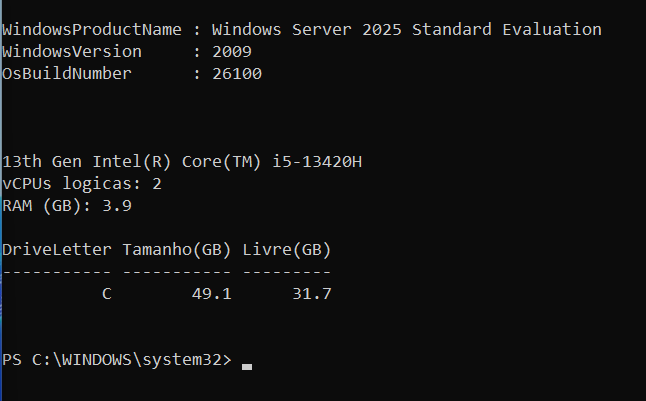
*Print 01 — Versão do Windows Server, vCPUs, memória e disco da VM SRV-ZELA01.*

---

## 4. Rede e identidade

Esta etapa dá ao servidor um endereço estável, um nome e um domínio. Sem isso, o DNS, o Active Directory e o site não têm onde se apoiar.

### 4.1 IP fixo

O adaptador deixou de usar DHCP e passou a usar um IP fixo. O servidor DNS do adaptador aponta para o próprio servidor, que também será o DNS do domínio.

```powershell
Set-NetIPInterface -InterfaceAlias $nome -Dhcp Disabled
New-NetIPAddress -InterfaceAlias $nome -IPAddress $ip -PrefixLength $prefix -DefaultGateway $gw
Set-DnsClientServerAddress -InterfaceAlias $nome -ServerAddresses $ip
ipconfig /all
```

*Print 02 — `ipconfig /all`: IPv4 estático (DHCP desabilitado), máscara, gateway e DNS apontando para o próprio servidor.*

### 4.2 Nome do servidor e domínio Active Directory

O servidor foi renomeado para `SRV-ZELA01`, recebeu as funções AD DS e DNS e foi promovido a controlador da floresta **`zelabairro.local`**.

```powershell
Rename-Computer -NewName "SRV-ZELA01" -Force
Install-WindowsFeature AD-Domain-Services, DNS -IncludeManagementTools
Install-ADDSForest -DomainName "zelabairro.local" -DomainNetbiosName "ZELA" -InstallDns:$true -SafeModeAdministratorPassword $dsrm -Force:$true
```

Após o reinício, o nome do servidor e o domínio foram conferidos:

```powershell
hostname
Get-CimInstance Win32_ComputerSystem | Format-List Name, Domain, PartOfDomain, DomainRole
```

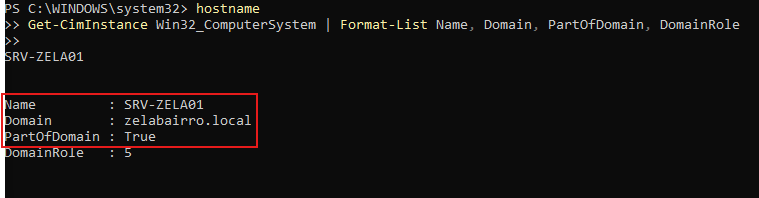
*Print 03 — Nome `SRV-ZELA01` e domínio `zelabairro.local` (PartOfDomain = True).*

O domínio e os serviços do Active Directory estão operacionais:

```powershell
Get-ADDomain | Format-List Name, DNSRoot, NetBIOSName, DomainMode, PDCEmulator
Get-ADForest | Format-List Name, ForestMode, RootDomain, SchemaMaster
Get-Service NTDS, DNS, ADWS, Netlogon
```

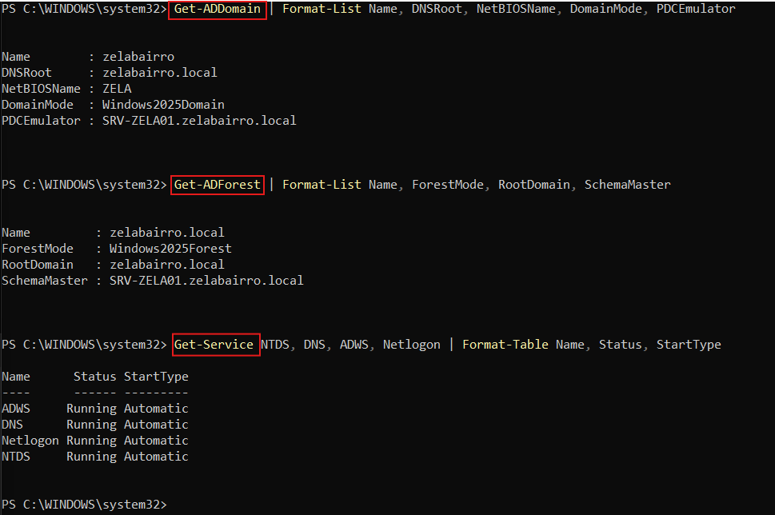
*Print 04 — Domínio `zelabairro.local` (NetBIOS `ZELA`) e serviços NTDS e DNS em execução.*

### 4.3 DNS

Foram criados o registro `app` (que aponta para o site), a zona reversa e o registro PTR do servidor. Um encaminhador permite que a VM continue resolvendo nomes da internet.

```powershell
Add-DnsServerResourceRecordA -Name "app" -ZoneName "zelabairro.local" -IPv4Address $ip
Add-DnsServerPrimaryZone -NetworkId "x.x.x.0/24" -ReplicationScope Domain
Add-DnsServerResourceRecordPtr -Name $o[3] -ZoneName "x.x.x.in-addr.arpa" -PtrDomainName "SRV-ZELA01.zelabairro.local"
Add-DnsServerForwarder -IPAddress 8.8.8.8

nslookup zelabairro.local
nslookup app.zelabairro.local
nslookup SRV-ZELA01.zelabairro.local
```

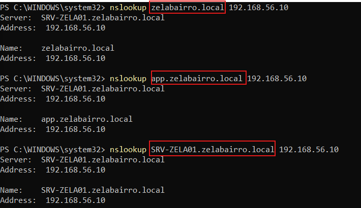
*Print 05 — `nslookup` resolvendo o domínio, `app.zelabairro.local` e o servidor para o IP fixo.*

As portas do DNS (53) e do LDAP (389) respondem:

```powershell
Test-NetConnection SRV-ZELA01.zelabairro.local -Port 53
Test-NetConnection SRV-ZELA01.zelabairro.local -Port 389
```

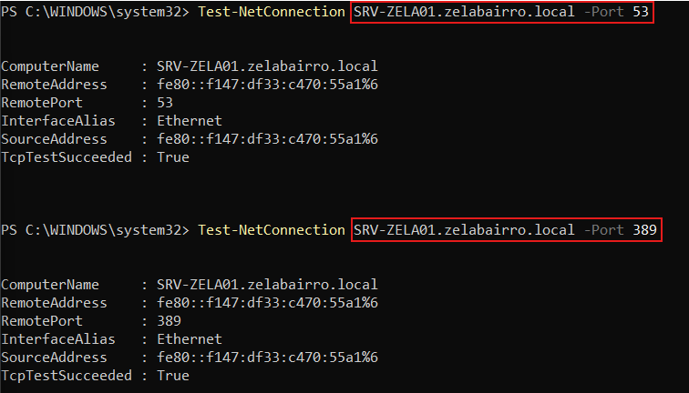
*Print 06 — `Test-NetConnection` com `TcpTestSucceeded = True` nas portas 53 e 389.*

### 4.4 Unidade organizacional, grupos e usuários simulados

A estrutura do domínio reflete o ecossistema do projeto: a OU `ZelaBairro` contém os grupos `GG_Agentes` (agentes públicos) e `GG_Admins_TI` (administração de TI). Os três usuários são fictícios.

```powershell
New-ADOrganizationalUnit -Name "ZelaBairro" -Path "DC=zelabairro,DC=local"
New-ADGroup -Name "GG_Agentes" -GroupScope Global -Path "OU=Usuarios,OU=ZelaBairro,DC=zelabairro,DC=local"
New-ADUser -Name "agente.sim01" -SamAccountName "agente.sim01" -AccountPassword $senha -Enabled $true ...
Add-ADGroupMember -Identity "GG_Agentes" -Members "agente.sim01","agente.sim02"
```

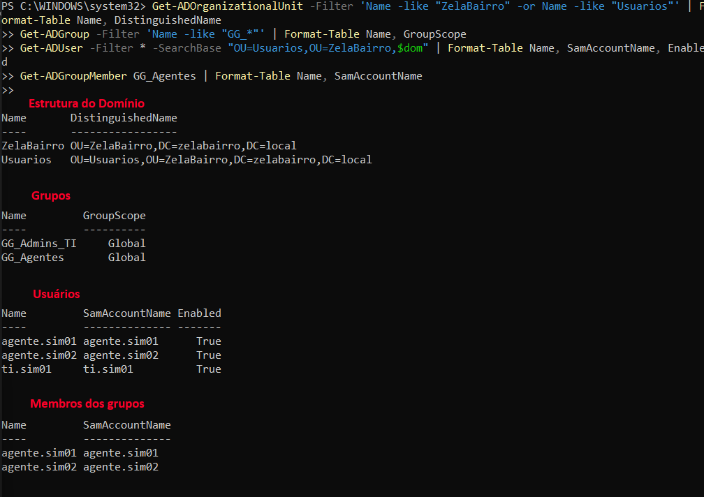
*Print 07 — OU `ZelaBairro`, grupos `GG_Agentes` e `GG_Admins_TI` e usuários simulados.*

---

## 5. Aplicação hospedada no IIS

A aplicação é publicada no IIS com um site e um pool próprios, em uma pasta protegida por permissões NTFS de menor privilégio.

### 5.1 Funções do IIS e dependências

Foram instaladas apenas as funções necessárias: servidor web, conteúdo estático, documento padrão, erros HTTP, registro de logs HTTP, monitor de requisições, filtragem de requisições, compressão estática e as ferramentas de gerenciamento e de script.

```powershell
Install-WindowsFeature -Name Web-Server, Web-Static-Content, Web-Default-Doc, Web-Http-Errors, Web-Http-Logging, Web-Request-Monitor, Web-Filtering, Web-Stat-Compression, Web-Mgmt-Console, Web-Scripting-Tools
Get-WindowsFeature Web-* | Where-Object Installed
```

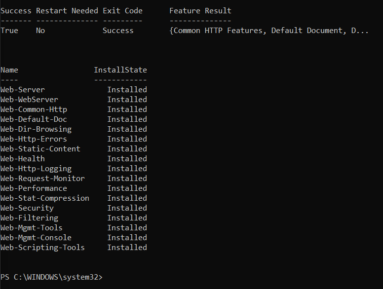
*Print 08 — Funções do IIS com `InstallState = Installed`.*

### 5.2 Pastas, arquivos e permissões NTFS

A pasta `C:\ZelaBairro` teve a herança removida e recebeu permissões explícitas: controle total apenas para `SYSTEM` e `Administrators`. O IIS (`IIS_IUSRS` e `IUSR`) só **lê** a pasta `Site`, e o grupo `ZELA\GG_Agentes` só **modifica** a pasta `Fotos`. Os arquivos da aplicação são `index.html`, `ocorrencias.json` (dados simulados) e `health.txt`.

```powershell
icacls C:\ZelaBairro /inheritance:r
icacls C:\ZelaBairro /grant "NT AUTHORITY\SYSTEM:(OI)(CI)F" "BUILTIN\Administrators:(OI)(CI)F"
icacls C:\ZelaBairro\Site  /grant "BUILTIN\IIS_IUSRS:(OI)(CI)RX" "NT AUTHORITY\IUSR:(OI)(CI)RX"
icacls C:\ZelaBairro\Fotos /grant "ZELA\GG_Agentes:(OI)(CI)M"
```

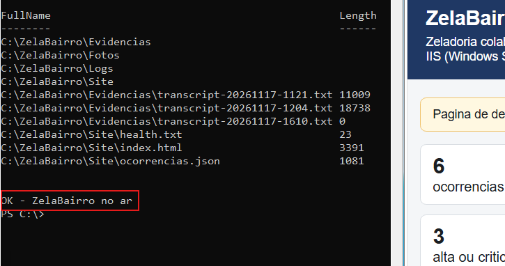
*Print 09 — Estrutura de pastas e arquivos da aplicação em `C:\ZelaBairro`.*

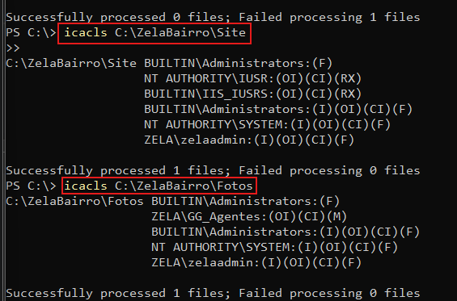
*Print 10 — `icacls` mostrando as permissões mínimas nas pastas `Site` e `Fotos`.*

### 5.3 Pool de aplicativos

O pool `ZelaBairroPool` roda **sem código gerenciado** (a página é estática), fica sempre em execução (`AlwaysRunning`), não é encerrado por inatividade e tem proteção contra falhas em sequência (5 falhas em 5 minutos).

```powershell
New-WebAppPool -Name "ZelaBairroPool"
Set-ItemProperty "IIS:\AppPools\ZelaBairroPool" -Name managedRuntimeVersion -Value ""
Set-ItemProperty "IIS:\AppPools\ZelaBairroPool" -Name startMode -Value "AlwaysRunning"
Set-ItemProperty "IIS:\AppPools\ZelaBairroPool" -Name failure.rapidFailProtection -Value $true
```

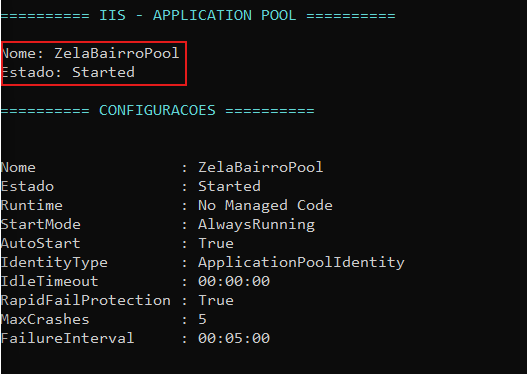
*Print 11 — Pool `ZelaBairroPool` iniciado, sem código gerenciado, `AlwaysRunning` e com proteção contra falhas rápidas.*

### 5.4 Site

O site `ZelaBairro` aponta para `C:\ZelaBairro\Site`, usa o pool acima e responde ao nome `app.zelabairro.local` na porta 80. Os logs do IIS são gravados em `C:\ZelaBairro\Logs`, e uma regra de firewall libera a porta 80.

```powershell
New-Website -Name "ZelaBairro" -PhysicalPath "C:\ZelaBairro\Site" -ApplicationPool "ZelaBairroPool" -Port 80 -HostHeader "app.zelabairro.local"
Set-ItemProperty "IIS:\Sites\ZelaBairro" -Name logFile.directory -Value "C:\ZelaBairro\Logs"
New-NetFirewallRule -DisplayName "ZelaBairro HTTP 80" -Direction Inbound -Protocol TCP -LocalPort 80 -Action Allow
```

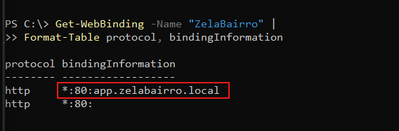
*Print 12 — Site `ZelaBairro` iniciado, com o caminho, o pool e o binding `app.zelabairro.local:80`.*

### 5.5 Validação da aplicação

```powershell
Invoke-WebRequest http://app.zelabairro.local/ -UseBasicParsing
Invoke-WebRequest http://app.zelabairro.local/ocorrencias.json -UseBasicParsing
Test-NetConnection app.zelabairro.local -Port 80
```

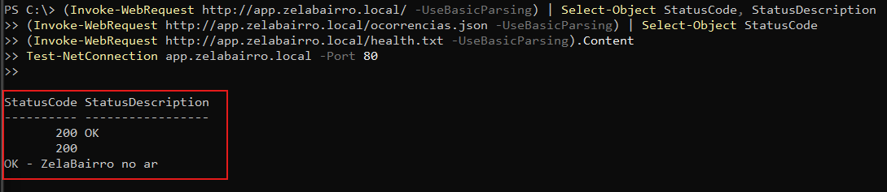
*Print 13 — Respostas HTTP 200 da página, do JSON e do `health.txt`, e porta 80 aberta.*

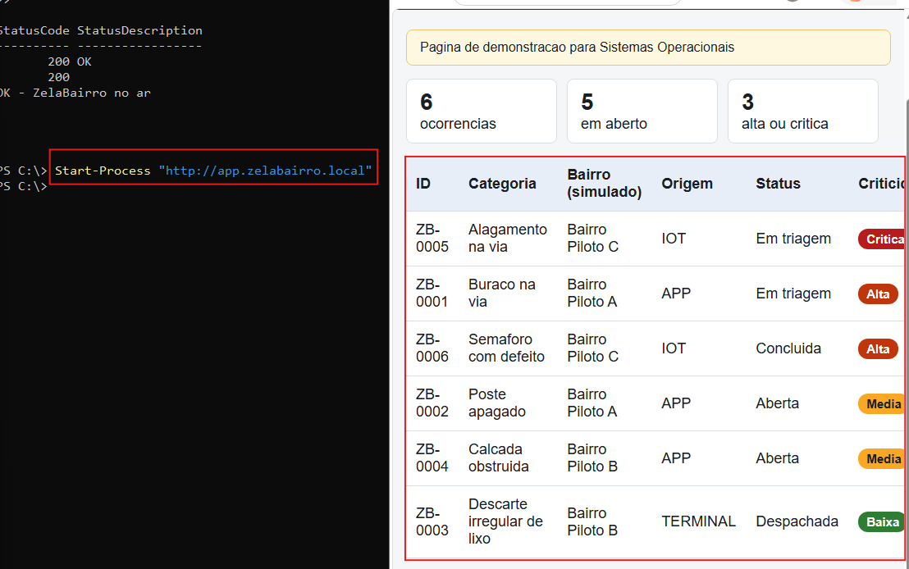
*Print 14 — Painel de ocorrências do ZelaBairro aberto em `http://app.zelabairro.local`.*

---

## 6. Serviços de arquivos, acesso remoto, GPO e auditoria

Esta etapa aplica os demais serviços do semestre ao ambiente do ZelaBairro.

### 6.1 Compartilhamento de arquivos (SMB)

A pasta `Fotos` é compartilhada como `FotosZelaBairro`: os agentes (`GG_Agentes`) podem alterar arquivos, os administradores do domínio têm controle total e o acesso de `Everyone` foi removido. As permissões do compartilhamento somam-se às permissões NTFS da pasta.

```powershell
Install-WindowsFeature FS-FileServer
New-SmbShare -Name "FotosZelaBairro" -Path "C:\ZelaBairro\Fotos" -FullAccess "ZELA\Domain Admins" -ChangeAccess "ZELA\GG_Agentes"
Revoke-SmbShareAccess -Name "FotosZelaBairro" -AccountName "Everyone" -Force
Get-SmbShareAccess -Name "FotosZelaBairro"
```

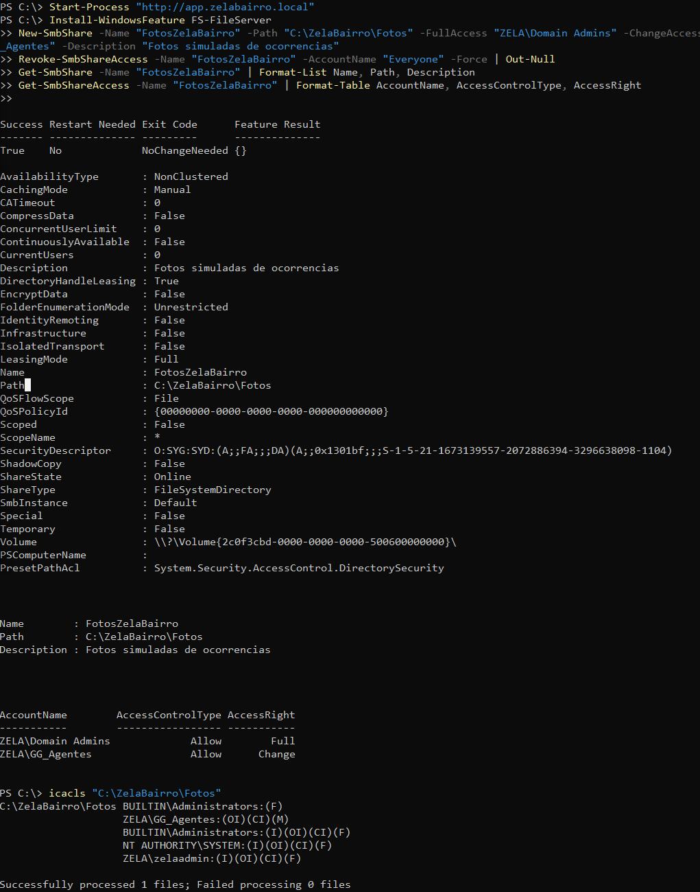
*Print 15 — Compartilhamento `FotosZelaBairro` com as permissões de `GG_Agentes` e `Domain Admins`.*

### 6.2 Acesso remoto

A Área de Trabalho Remota foi habilitada, com autenticação em nível de rede, para a administração do servidor.

```powershell
Set-ItemProperty "HKLM:\System\CurrentControlSet\Control\Terminal Server" -Name fDenyTSConnections -Value 0
Enable-NetFirewallRule -DisplayGroup "Remote Desktop"
Test-NetConnection localhost -Port 3389
```

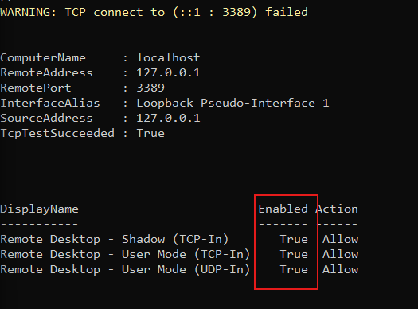
*Print 16 — Porta 3389 aberta e regras de Remote Desktop habilitadas.*

### 6.3 Políticas de grupo (GPO)

Duas GPOs foram criadas. A `GPO-ZelaBairro-Usuarios` ativa o bloqueio de tela protegido por senha após 10 minutos de inatividade e está vinculada à OU `ZelaBairro`. A `GPO-ZelaBairro-Servidores` exibe um aviso legal no logon e está vinculada à OU `Domain Controllers`.

```powershell
New-GPO -Name "GPO-ZelaBairro-Usuarios"
Set-GPRegistryValue -Name "GPO-ZelaBairro-Usuarios" -Key "HKCU\Software\Policies\Microsoft\Windows\Control Panel\Desktop" -ValueName ScreenSaveTimeOut -Type String -Value "600"
New-GPLink -Name "GPO-ZelaBairro-Usuarios" -Target "OU=ZelaBairro,DC=zelabairro,DC=local"
gpupdate /force
gpresult /scope computer /r
```

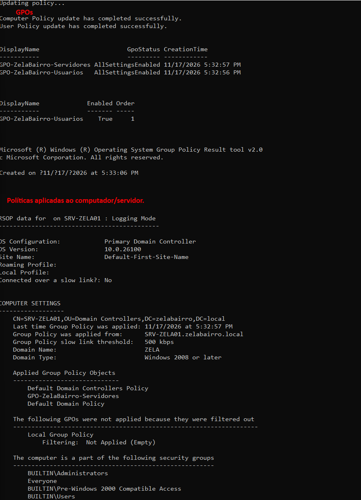
*Print 17 — GPOs `GPO-ZelaBairro-*` criadas, vinculadas e aplicadas.*

### 6.4 Política de senhas e bloqueio de contas

A política do domínio exige senhas de no mínimo 10 caracteres com complexidade e bloqueia a conta por 15 minutos após 5 tentativas erradas.

```powershell
Set-ADDefaultDomainPasswordPolicy -Identity "zelabairro.local" -MinPasswordLength 10 -ComplexityEnabled $true -LockoutThreshold 5 -LockoutDuration "00:15:00" -LockoutObservationWindow "00:15:00"
Get-ADDefaultDomainPasswordPolicy
```

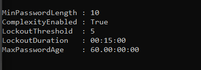
*Print 18 — Política de senhas do domínio: tamanho mínimo, complexidade e bloqueio de conta.*

### 6.5 Auditoria

A auditoria de **Logon** e de **Sistema de Arquivos** foi ativada para sucesso e falha. Uma tentativa de logon com senha errada foi feita de propósito para gerar o evento de falha, que aparece ao lado dos logons bem-sucedidos no log de Segurança (eventos 4624 e 4625).

```powershell
auditpol /set /subcategory:"{0CCE9215-69AE-11D9-BED3-505054503030}" /success:enable /failure:enable
auditpol /set /subcategory:"{0CCE921D-69AE-11D9-BED3-505054503030}" /success:enable /failure:enable
Get-WinEvent -FilterHashtable @{LogName='Security'; Id=4624} -MaxEvents 3
Get-WinEvent -FilterHashtable @{LogName='Security'; Id=4625} -MaxEvents 3
```

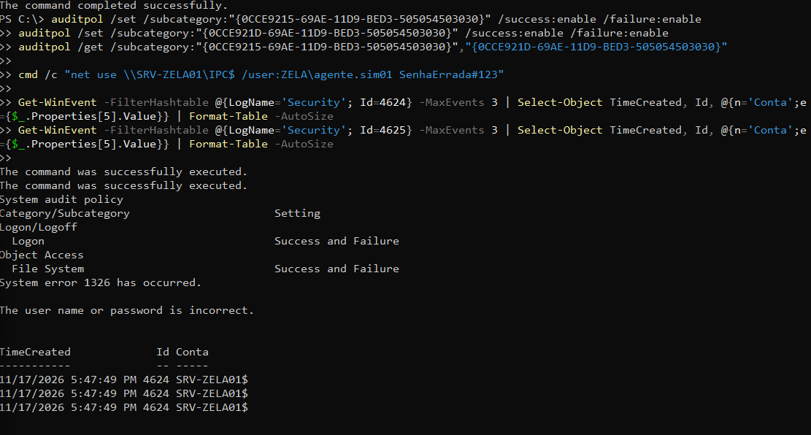
*Print 19 — Auditoria habilitada e eventos 4624 (logon com sucesso) e 4625 (falha de logon).*

---

## 7. Monitoramento

O Monitor de Desempenho foi configurado com um conjunto de alertas que observa três recursos a cada 10 segundos e registra no log de eventos quando um limite é ultrapassado.

- **CPU:** uso do processador acima de 85%.
- **Memória:** memória comprometida acima de 85%.
- **Disco:** espaço livre do disco C: abaixo de 15%.

O conjunto `ZelaBairro-Alertas` também é iniciado automaticamente na inicialização do servidor, por uma tarefa agendada.


```powershell
logman create alert "ZelaBairro-Alertas" -th "\Processor(_Total)\% Processor Time>85" "\Memory\% Committed Bytes In Use>85" "\LogicalDisk(C:)\% Free Space<15" -si 10 -el
logman start "ZelaBairro-Alertas"
schtasks /create /tn "Iniciar-ZelaBairro-Alertas" /tr "logman start ZelaBairro-Alertas" /sc onstart /ru SYSTEM /f
```

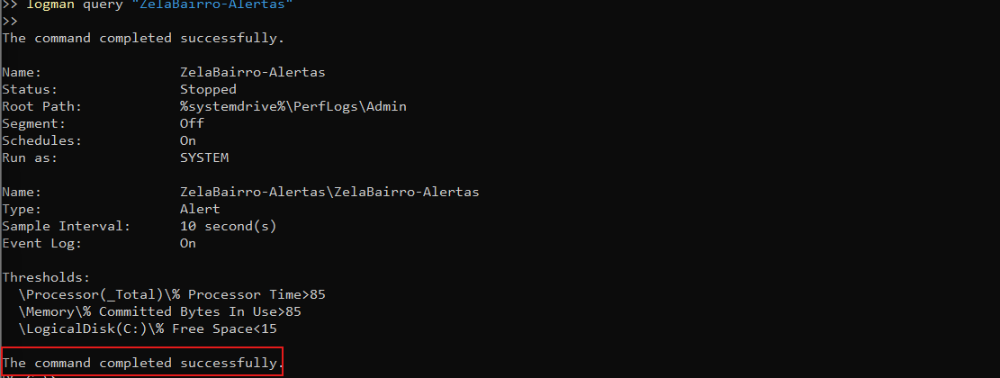
*Print 20 — `logman query ZelaBairro-Alertas` com os três limites: CPU, memória e disco.*

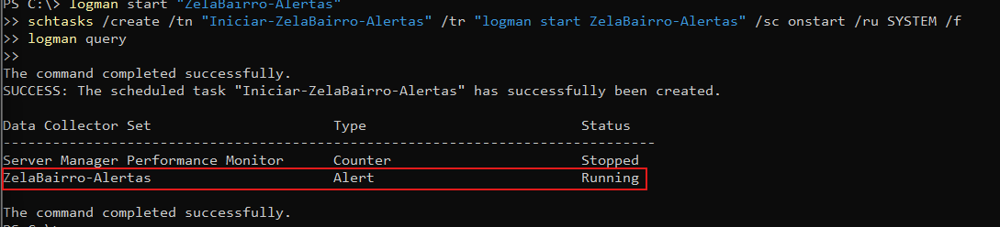
*Print 21 — `logman query`: conjunto `ZelaBairro-Alertas` em execução.*

**Teste do alerta de CPU.** Um teste de carga manteve todos os núcleos acima de 85% por cerca de 90 segundos, enquanto o uso de CPU era medido a cada 5 segundos.

```powershell
$jobs = 1..([Environment]::ProcessorCount) | ForEach-Object { Start-Job { $fim=(Get-Date).AddSeconds(90); while((Get-Date) -lt $fim){ [math]::Sqrt(12345) | Out-Null } } }
1..8 | ForEach-Object { (Get-Counter "\Processor(_Total)\% Processor Time").CounterSamples.CookedValue; Start-Sleep 5 }
```

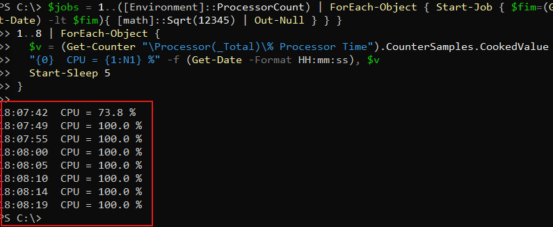
*Print 22 — Uso de CPU acima de 85% durante o teste de carga.*

O alerta disparado foi registrado nos logs do Windows:

```powershell
Get-WinEvent -LogName Application -MaxEvents 300 | Where-Object { $_.Message -match "ZelaBairro-Alertas|Processor Time" }
Get-WinEvent -LogName "Microsoft-Windows-Diagnosis-PLA/Operational" -MaxEvents 10
```

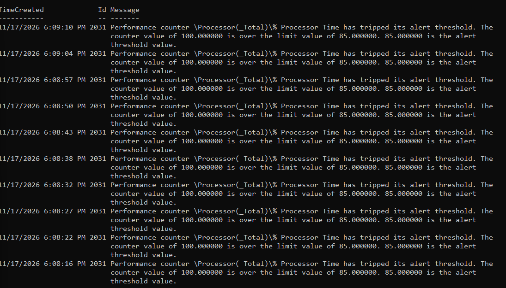
*Print 23 — Evento do alerta de desempenho registrado no log de eventos.*

---

## 8. Tolerância a falhas e teste de falha

A recuperação automática foi configurada em duas camadas e depois comprovada com dois testes de falha.

- **Serviços:** `W3SVC` (serviço de publicação na web) e `WAS` (ativação de processos do Windows) reiniciam sozinhos após uma falha, com esperas de 5, 10 e 30 segundos nas três primeiras ocorrências.
- **Pool de aplicativos:** `ZelaBairroPool` fica sempre em execução (`AlwaysRunning`) e conta com a proteção contra falhas rápidas configurada na seção 5.3.

### 8.1 Configuração da recuperação


```powershell
sc.exe failure W3SVC reset= 86400 actions= restart/5000/restart/10000/restart/30000
sc.exe failure WAS    reset= 86400 actions= restart/5000/restart/10000/restart/30000
sc.exe qfailure W3SVC
```

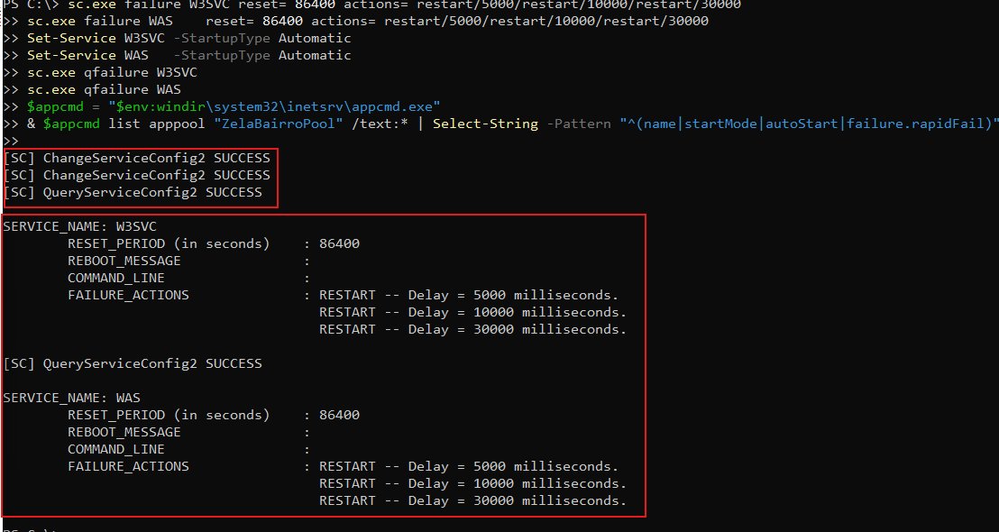
*Print 24 — Ações de recuperação dos serviços `W3SVC` e `WAS` e configuração do pool.*

### 8.2 Teste de falha 1: processo do pool de aplicativos

O processo `w3wp.exe` do pool foi encerrado à força. O IIS recriou o processo sozinho e o site voltou a responder, o que se prova pela comparação entre o PID antigo e o novo.

```powershell
$old = [int](& $appcmd list wp /apppool.name:ZelaBairroPool /text:wp.name)
Stop-Process -Id $old -Force
Start-Sleep 8
$new = [int](& $appcmd list wp /apppool.name:ZelaBairroPool /text:wp.name)
"PID ANTIGO: $old   |   PID NOVO: $new"
```

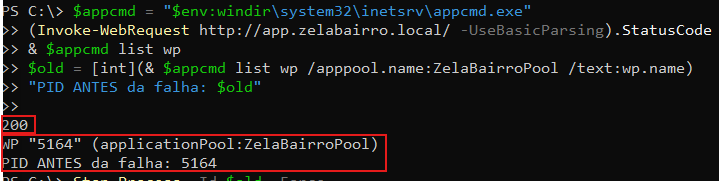
*Print 25 — Estado **antes** da falha: PID do `w3wp.exe` do pool e site respondendo HTTP 200.*

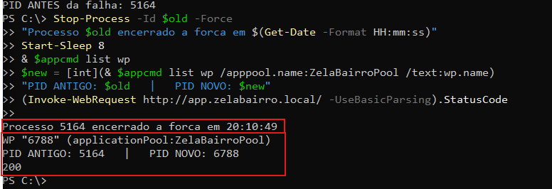
*Print 26 — Estado **depois** da falha: PID antigo encerrado, novo PID criado automaticamente e site respondendo HTTP 200.*

### 8.3 Teste de falha 2: serviço do IIS

O processo que hospeda o serviço `W3SVC` foi encerrado à força, simulando uma falha do serviço. A regra de recuperação o reiniciou em poucos segundos, sem intervenção manual. Foi usado `taskkill` e não `Stop-Service`, porque uma parada manual não aciona a recuperação automática.

```powershell
$svcpid = (Get-CimInstance Win32_Service -Filter "Name='W3SVC'").ProcessId
taskkill /PID $svcpid /F
Start-Sleep 25
Get-Service W3SVC, WAS
```

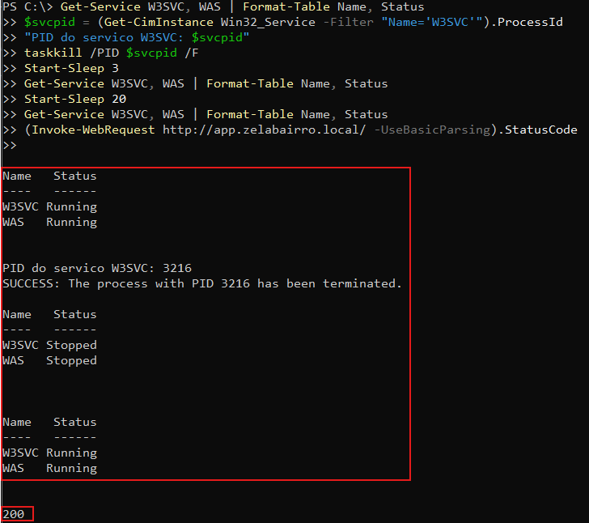
*Print 27 — `W3SVC` e `WAS` de volta ao estado `Running` após a falha, e site respondendo.*

---

## 9. Logs de auditoria e acompanhamento

Os registros da falha e da recuperação ficam em dois lugares: o Visualizador de Eventos (log do Sistema) e os logs do IIS.


**Log do Sistema.** Os eventos dos provedores `WAS` e `Service Control Manager` registram a queda e a recuperação dos serviços, com data e hora.

```powershell
Get-WinEvent -FilterHashtable @{LogName='System'; StartTime=(Get-Date).AddMinutes(-60); ProviderName='Microsoft-Windows-WAS','Service Control Manager'}
```

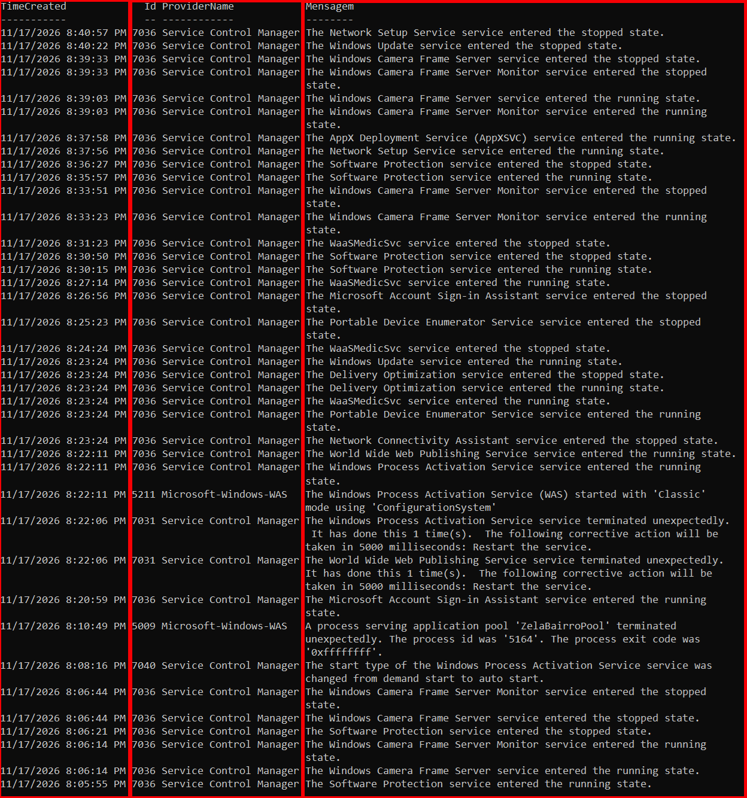
*Print 28 — Eventos de queda e recuperação do IIS no log do Sistema.*

**Logs do IIS.** Cada requisição ao site fica registrada em `C:\ZelaBairro\Logs`, com método, caminho e código de resposta.

```powershell
netsh http flush logbuffer
Get-ChildItem C:\ZelaBairro\Logs -Recurse -Filter *.log
Get-Content $log.FullName -Tail 12
```

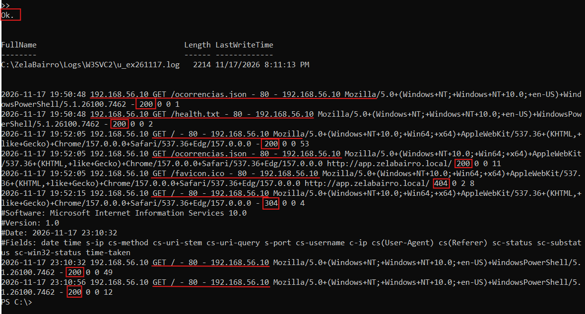
*Print 29 — Arquivo de log do IIS com as requisições `GET` e o código 200.*

---

## 10. Verificação final

Uma verificação final consolida o estado da solução: nome do servidor, domínio, resolução DNS do site, serviços do Active Directory e do IIS, pool, site, resposta HTTP, compartilhamento e alerta de desempenho.


```powershell
[pscustomobject]@{
  Hostname = $env:COMPUTERNAME
  Dominio  = (Get-ADDomain).DNSRoot
  DNS_app  = (Resolve-DnsName app.zelabairro.local -Type A).IPAddress
  W3SVC    = (Get-Service W3SVC).Status
  Pool     = (Get-WebAppPoolState ZelaBairroPool).Value
  Site     = (Get-WebsiteState ZelaBairro).Value
  HTTP     = (Invoke-WebRequest http://app.zelabairro.local/ -UseBasicParsing).StatusCode
  Share    = (Get-SmbShare FotosZelaBairro).Name
} | Format-List
```

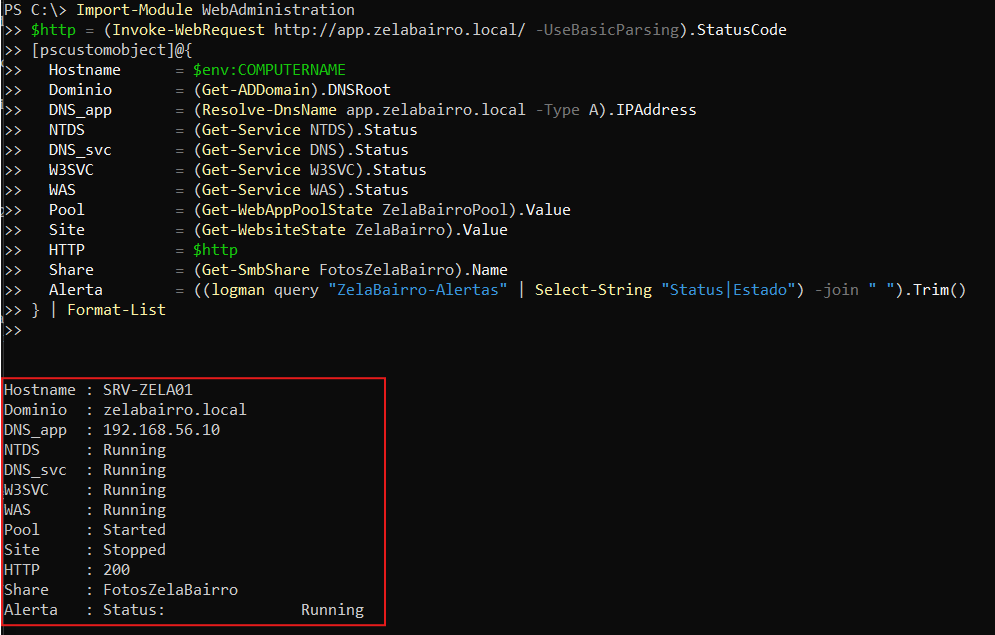
*Print 30 — Verificação final: todos os componentes da infraestrutura em estado normal.*

---

## 11. Estrutura do repositório

```
zelabairro-so/
├── README.md                 
├── app/
│   ├── index.html            página hospedada no IIS
│   ├── ocorrencias.json      dados simulados
│   └── health.txt
└── evidencias/
    ├── GS-SO.mp4             vídeo de demonstração da infraestrutura
    ├── 01-hardware-vm.png ... 30-verificacao-final.png
    └── transcript-*.txt      registro de todos os comandos da sessão
```

## 12. Conclusão

A VM `SRV-ZELA01` entrega uma infraestrutura Windows Server funcional para o ZelaBairro: identidade e nomes com Active Directory e DNS, a aplicação publicada no IIS com permissões de menor privilégio, serviços de arquivos, GPOs e auditoria, monitoramento de CPU, memória e disco e recuperação automática de falhas, comprovada por dois testes. Todo o ambiente usa apenas dados simulados, em conformidade com a LGPD.
